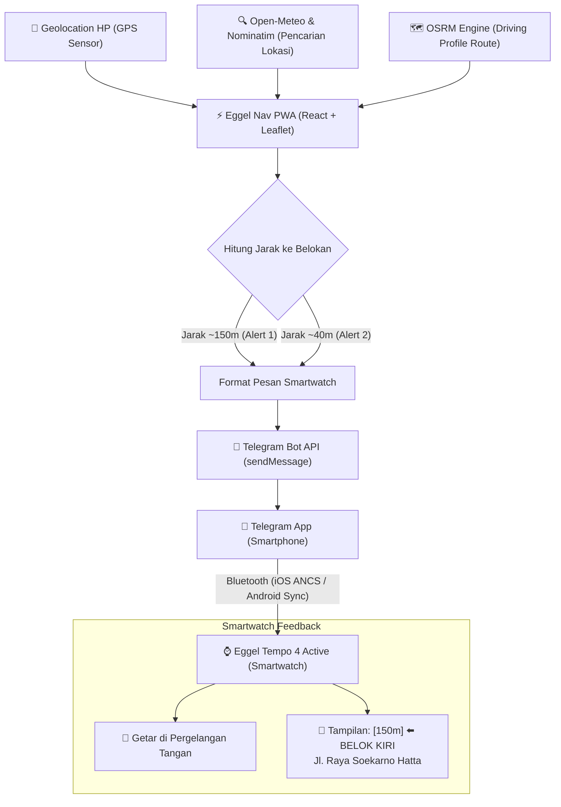

# 🏍️ Eggel Nav

> **Turn-by-Turn Motorcycle Navigation PWA for Eggel Tempo 4 Active Smartwatch**  
> Navigasi motor bergetar langsung di pergelangan tangan Anda via integrasi Telegram Bot & iOS ANCS / Android Notification Sync.

---

## 📌 Sekilas Tentang Project

**Eggel Nav** adalah aplikasi navigasi Turn-by-Turn berbasis **Progressive Web App (PWA)** yang dirancang khusus untuk pengendara sepeda motor yang menggunakan smartwatch seperti **Eggel Tempo 4 Active** (maupun smartwatch lain yang mendukung sinkronisasi notifikasi Bluetooth).

Smartwatch kelas budget pada umumnya tidak memiliki sistem operasi mandiri (WearOS/watchOS) ataupun aplikasi Google Maps bawaan. Namun, smartwatch ini memiliki motor getar (*haptic vibration*) dan layar jernih yang secara konsisten menerima notifikasi pesan (seperti Telegram atau WhatsApp) dari smartphone.

**Eggel Nav memecahkan masalah ini dengan cerdas:**  
Smartphone menghitung rute dan posisi GPS secara presisi, lalu mengirimkan instruksi belokan ringkas tepat waktu ke Telegram Bot pribadi Anda. Notifikasi tersebut secara otomatis diteruskan oleh Bluetooth (via ANCS pada iPhone atau Notification Listener pada Android) ke smartwatch Anda—menghasilkan **getaran di pergelangan tangan** dan **tampilan arah panah belokan** tanpa Anda harus memegang atau menatap layar smartphone saat berkendara.

---

## ✨ Fitur Utama

- 🧭 **Turn-by-Turn Motorcycle Navigation**: Perutean khusus kendaraan bermotor memanfaatkan engine Open Source Routing Machine (OSRM) dengan instruksi manuver visual yang presisi.
- 📳 **Smartwatch Haptic Vibration (Dual-Alert System)**:
  - **Peringatan 1 (Advance Turn Warning ~150m)**: Memberi getaran dan info persiapan belokan berikutnya (`[150m] ⬅️ BELOK KIRI`).
  - **Peringatan 2 (Imminent Turn Execution ~40m)**: Memberi getaran tegas saat eksekusi manuver belokan tepat di depan (`[40m] ⬅️ BELOK KIRI SEKARANG`).
- 🔍 **Pencarian Cerdas Anti-429 (Hybrid Geocoding)**:
  - **Open-Meteo Geocoding** sebagai pencari utama tanpa batas kuota (*zero 429 rate-limit*), cepat (<50ms), dan mencakup seluruh kelurahan/kecamatan/kota di Indonesia.
  - **OSM Nominatim Fallback** dengan mekanisme *pacing request* ketat (1.200ms) untuk melindungi dari pemblokiran kuota.
  - **In-Memory Query Cache**: Menghemat bandwidth dan mencegah request ganda pada pencarian berulang.
  - **Auto-Resolution Perumahan**: Mampu mengenali perumahan cluster privat (misal *Patraland Tasikmadu Malang*) dan memetakannya ke area administratif terkait.
- 🔋 **Background & Sensor Keep-Alive (iOS & Android)**:
  - **Silent Audio Loop & WebAudio Oscillator**: Menjaga GPS tetap aktif dan tidak di-*freeze* oleh sistem operasi saat layar smartphone mati atau disimpan di dalam saku celana / jaket.
  - **Screen WakeLock API**: Mencegah layar redup/terkunci otomatis saat smartphone diletakkan pada holder stang motor.
- 🎨 **Eggel Active Athletic Styling**:
  - Didesain mengikuti bahasa visual **Eggel Active sports**: *Carbon Black (`#0f0f12`), Electric Lime (`#d2fc15`), dan Sky Cyan (`#38bdf8`)*.
  - Dukungan penuh mode gelap (**Dark Mode**) dan terang (**Light Mode**).
  - Tampilan HUD navigasi besar dan mudah dibaca sekilas saat berkendara.
- 🌐 **Dua Bahasa (Bilingual)**: Tersedia pilihan Bahasa Indonesia dan English.
- 💸 **100% Free & Open-Source**: Tanpa API key berbayar, tanpa biaya langganan Google Maps Platform atau Mapbox.

---

## 🏗️ Alur Arsitektur Sistem



---

## 🛠️ Tech Stack

| Komponen | Teknologi |
| :--- | :--- |
| **Framework** | [React 19](https://react.dev/) + [Vite](https://vite.dev/) |
| **Styling** | [Tailwind CSS v4](https://tailwindcss.com/) |
| **Map Rendering** | [Leaflet](https://leafletjs.com/) (OpenStreetMap Tile Layer) |
| **Routing Service** | [OSRM Driving API](http://project-osrm.org/) |
| **Geocoding** | [Open-Meteo Geocoding](https://open-meteo.com/en/docs/geocoding-api) & [OSM Nominatim](https://nominatim.openstreetmap.org/) |
| **Notifikasi Jam** | [Telegram Bot API](https://core.telegram.org/bots/api) |
| **Keep-Alive** | Web Audio API, HTML5 Audio Loop, Screen WakeLock API |
| **Icons** | [Lucide React](https://lucide.dev/) |
| **Linter** | [Oxlint](https://oxc.rs/) |

---

## 🚀 Memulai Instalasi & Menjalankan Lokal

### Prasyarat
- [Node.js](https://nodejs.org/) versi 18 atau lebih baru.
- Koneksi internet untuk memuat tile peta OpenStreetMap dan OSRM routing.

### 1. Clone & Pasang Dependensi
```bash
git clone https://github.com/username/eggel-nav.git
cd eggel-nav
npm install
```

### 2. Jalankan Development Server
```bash
npm run dev -- --host
```
Flag `--host` diperlukan agar aplikasi dapat diakses dari smartphone Anda yang berada dalam satu jaringan Wi-Fi / Hotspot yang sama.

Aplikasi akan berjalan pada:
- **Komputer Lokal**: `http://localhost:5173/`
- **Smartphone (Wi-Fi)**: `http://<IP-KOMPUTER-ANDA>:5173/` (contoh: `http://192.168.1.10:5173/`)

### 3. Build untuk Production
```bash
npm run build
npm run preview
```

---

## ⚙️ Panduan Menghubungkan ke Eggel Tempo 4 Active

Agar notifikasi navigasi dan getaran dapat diterima di jam tangan pintar Anda:

### Langkah 1: Buat Telegram Bot Pribadi
1. Buka aplikasi **Telegram** di smartphone Anda.
2. Cari akun **`@BotFather`** dan kirim perintah `/newbot`.
3. Ikuti instruksi untuk memberi nama bot (misal: *Navigasi Motor Saya*).
4. Anda akan mendapatkan **HTTP API Token** (contoh format: `8863619482:AAH_lEWklKmgu...`). Simpan token ini.

### Langkah 2: Dapatkan Chat ID Anda
1. Cari akun **`@userinfobot`** di Telegram dan klik tombol **Start**.
2. Bot akan membalas dengan menampilkan nomor **Id** Anda (contoh: `5694188432`). Simpan ID ini.
3. Buka bot yang baru saja Anda buat di Langkah 1, lalu klik **Start** (atau kirim pesan apa saja) agar bot memiliki izin mengirimkan pesan ke akun Anda.

### Langkah 3: Konfigurasi di Eggel Nav
1. Buka **Eggel Nav** di browser smartphone Anda.
2. Tekan tombol gear **Settings (Pengaturan)** di pojok kanan atas.
3. Masukkan **Telegram Bot Token** dan **Telegram Chat ID** Anda.
4. Tekan tombol **"Test Watch Vibration Now" / "Uji Getar Jam Sekarang"**.
5. Smartwatch Eggel Anda akan langsung **bergetar** dan menampilkan pesan uji coba navigasi!

### Langkah 4: Pastikan Izin Notifikasi Smartwatch Aktif
- Buka aplikasi pendamping jam di HP Anda (**Eggel Fit**, **GloryFit**, atau aplikasi Bluetooth Sync lainnya).
- Masuk ke menu **Device** > **Notification / App Alerts**.
- Pastikan opsi **Telegram** dalam keadaan **Aktif (ON)**.

---

## 📱 Panduan PWA (Instalasi di Layar Utama HP)

Eggel Nav telah dilengkapi `manifest.json` dan `Service Worker` standar PWA:

- **Pengguna iOS (Safari)**:
  1. Buka link Eggel Nav di browser Safari.
  2. Tekan tombol **Share** (ikon kotak dengan panah ke atas) di menu bawah Safari.
  3. Pilih **"Add to Home Screen" (Tambahkan ke Layar Utama)**.
  4. Aplikasi akan terpasang layaknya aplikasi native tanpa bar browser.

- **Pengguna Android (Chrome)**:
  1. Buka link Eggel Nav di Google Chrome.
  2. Tekan tombol menu titik tiga di pojok kanan atas.
  3. Pilih **"Install App"** atau **"Add to Home screen"**.

---

## 📁 Struktur Direktori

```text
eggel-nav/
├── public/
│   ├── favicon.svg              # Favicon Eggel Nav
│   ├── icon-192.png             # Ikon PWA 192x192
│   ├── icon-512.png             # Ikon PWA 512x512
│   ├── apple-touch-icon.png     # Ikon Home Screen iOS
│   ├── manifest.json            # Web App Manifest PWA
│   └── sw.js                    # Service Worker caching
├── src/
│   ├── components/
│   │   ├── Map.jsx              # Komponen Leaflet peta, marker, dan polyline rute
│   │   ├── NavigationHUD.jsx    # Tampilan HUD belokan, sisa jarak, & estimasi waktu
│   │   ├── SearchModal.jsx      # Modal pencarian tempat dengan auto-debounce & clean UI
│   │   └── SettingsModal.jsx    # Modal pengaturan Telegram, ambang batas jarak, & bahasa
│   ├── utils/
│   │   ├── audioKeepAlive.js    # Silent audio loop & WakeLock untuk background tracking
│   │   ├── geo.js               # Perhitungan Haversine, bearing, jarak polyline, format teks
│   │   ├── i18n.js              # Kamus lokalisasi Bahasa Indonesia & English
│   │   ├── osrm.js              # Integrasi OSRM routing, Open-Meteo geocoding & pacing Nominatim
│   │   └── telegram.js          # Pengiriman alert Telegram & format teks layar smartwatch
│   ├── App.jsx                  # Logika utama navigasi, GPS tracking, & alur state
│   ├── main.jsx                 # Entry point React & registrasi Service Worker
│   └── index.css                # Konfigurasi Tailwind CSS v4 & custom theme styles
├── package.json
├── vite.config.js               # Konfigurasi Vite & proxy Nominatim anti-CORS
└── README.md
```

---

## 🔒 Privasi & Keamanan

- Semua token Telegram dan pengaturan disimpan secara lokal di dalam browser Anda menggunakan `localStorage`.
- Posisi GPS Anda hanya digunakan langsung di perangkat Anda untuk menghitung rute dan tidak disimpan di server pihak ketiga manapun.

---

## 📄 Lisensi

Project ini dirilis di bawah lisensi [MIT](LICENSE). Bebas digunakan, dimodifikasi, dan dikembangkan untuk keperluan pribadi maupun komunitas pengendara motor.
