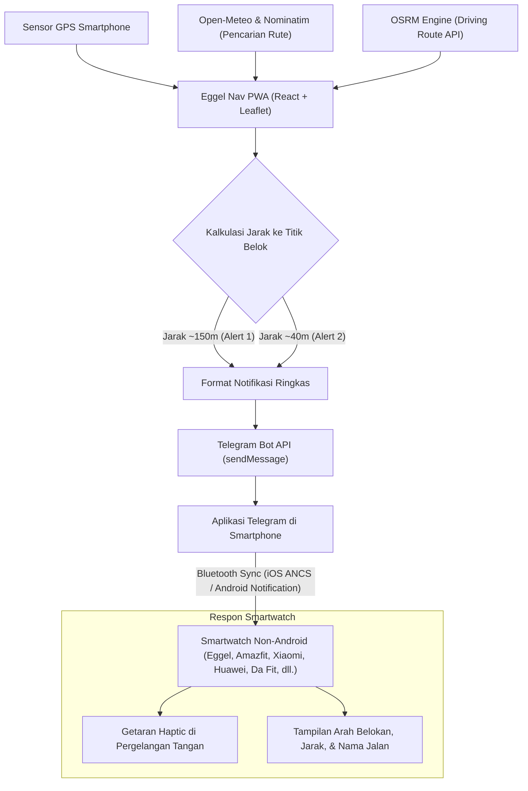

# Eggel Nav

> Universal Turn-by-Turn Motorcycle Navigation PWA for Non-Android Smartwatches  
> Solusi navigasi motor dengan notifikasi getar dan panduan arah belokan untuk semua smartwatch non-Android (RTOS) melalui integrasi Telegram Bot dan sinkronisasi notifikasi iOS (ANCS) / Android.

---

## Sekilas Tentang Project

**Eggel Nav** adalah aplikasi navigasi Turn-by-Turn berbasis **Progressive Web App (PWA)** yang dirancang untuk **semua smartwatch non-Android** (perangkat yang tidak menjalankan WearOS atau watchOS, melainkan sistem operasi tertanam/RTOS).

### Masalah pada Smartwatch Non-Android
Smartwatch kategori RTOS, fitness tracker, maupun smartwatch harian (seperti seri Eggel Tempo, Amazfit, Xiaomi/Redmi Smart Band, Huawei Band/Watch GT, Haylou, serta smartwatch berbasis aplikasi Da Fit, GloryFit, atau FitCloudPro) umumnya memiliki keterbatasan:
- Tidak memiliki toko aplikasi (tidak dapat menginstal Google Maps atau Waze secara langsung).
- Tidak memiliki GPS mandiri yang terhubung ke aplikasi navigasi pihak ketiga.

Namun, hampir seluruh smartwatch non-Android memiliki dua keunggulan utama:
1. **Motor getar (*haptic vibration*)** yang kuat di pergelangan tangan.
2. **Koneksi Bluetooth** yang secara konsisten dan andal menerima sinkronisasi notifikasi pesan (seperti Telegram, SMS, atau WhatsApp) dari smartphone.

### Solusi Jembatan Notifikasi (Notification Bridge)
Eggel Nav memanfaatkan keunggulan tersebut dengan pendekatan jembatan notifikasi:
1. Smartphone memproses kalkulasi rute jalan dan pergerakan GPS secara real-time.
2. Saat mendekati titik belokan, Eggel Nav secara otomatis mengirimkan instruksi manuver ringkas ke Telegram Bot pribadi pengguna.
3. Notifikasi pesan Telegram tersebut seketika diteruskan oleh sistem operasi ponsel melalui Bluetooth (via Apple Notification Center Service / ANCS pada iOS atau Notification Listener pada Android) langsung ke jam tangan pintar.
4. **Hasilnya:** Smartwatch non-Android Anda akan **bergetar** di pergelangan tangan dan memunculkan **instruksi arah belokan** di layar jam tanpa Anda perlu memasang holder HP atau menatap layar smartphone saat berkendara.

---

## Kompatibilitas Perangkat

Solusi ini bekerja secara universal pada seluruh jam tangan pintar yang mendukung penerimaan notifikasi pesan dari smartphone, termasuk namun tidak terbatas pada:
- **Eggel**: Eggel Tempo 4 Active, Tempo 3, Tempo 2, dan seluruh lini smartwatch Eggel.
- **Xiaomi & Redmi**: Redmi Watch series, Xiaomi Smart Band series (Mi Band 4, 5, 6, 7, 8, 9).
- **Huawei & Honor**: Huawei Band series, Huawei Watch Fit series, Huawei Watch GT series.
- **Amazfit**: Amazfit Bip, GTS, GTR, T-Rex, Band series (via Zepp / Zepp Life).
- **Haylou**: Haylou Solar, RS series, GST, RT.
- **Smartwatch Berbasis Aplikasi Pendamping Generik**: Semua jam yang menggunakan aplikasi pendamping seperti **Da Fit**, **GloryFit**, **FitCloudPro**, **VeryFit**, **H Band**, atau **Wearfit Pro**.
- **Garmin & Suunto**: Seluruh lini smartwatch Garmin atau Suunto yang mengaktifkan fitur *Smart Notifications*.

---

## Fitur Utama

- **Turn-by-Turn Motorcycle Navigation**: Perutean kendaraan bermotor menggunakan engine Open Source Routing Machine (OSRM) dengan instruksi manuver visual yang presisi.
- **Smartwatch Haptic Vibration (Dual-Alert System)**:
  - **Peringatan 1 (Advance Turn Warning ~150m)**: Memberi getaran persiapan awal sebelum belokan (misal: `[150m] BELOK KIRI`).
  - **Peringatan 2 (Imminent Turn Execution ~40m)**: Memberi getaran penegasan saat titik belokan berada tepat di depan (misal: `[40m] BELOK KIRI SEKARANG`).
- **Pencarian Lokasi Cerdas (Hybrid Geocoding)**:
  - **Open-Meteo Geocoding** sebagai mesin pencari primer: bebas kuota (tanpa batasan 1 req/detik), latensi sangat rendah (<50ms), serta mencakup data administratif kelurahan, kecamatan, dan kota di Indonesia.
  - **OSM Nominatim Fallback**: Dilengkapi *pacing request* otomatis (1.200ms) untuk mencegah pemblokiran kuota saat mencari nama gedung atau tempat komersial spesifik.
  - **In-Memory Query Cache**: Mencegah panggilan jaringan berulang pada kata kunci pencarian yang sama.
  - **Auto-Resolution Area Perumahan**: Memetakan pencarian nama perumahan cluster (contoh: *Patraland Tasikmadu Malang*) ke entitas administratif yang terdaftar di OpenStreetMap.
- **Background & Sensor Keep-Alive (iOS & Android)**:
  - **Silent Audio Loop & WebAudio Oscillator**: Menjaga proses GPS tetap berjalan di latar belakang saat smartphone berada di dalam saku celana atau layar ponsel dalam keadaan terkunci.
  - **Screen WakeLock API**: Menjaga layar tetap aktif saat smartphone diletakkan pada holder stang motor.
- **Estimasi Waktu & Kecepatan Stabil**:
  - Menggunakan profil kecepatan jalan resmi dari OSRM per segmen rute sehingga estimasi sisa waktu tidak melonjak drastis saat berhenti di lampu merah.
  - Format waktu kedatangan 24 jam dengan penanda zona waktu lokal Indonesia otomatis (WIB, WITA, WIT).
- **Desain Atletik & Mode Tampilan**:
  - Palet warna athletic: Carbon Black (`#0f0f12`), Electric Lime (`#d2fc15`), dan Sky Cyan (`#38bdf8`).
  - Dukungan tema Dark Mode dan Light Mode.
  - Penyesuaian penuh Safe Area Insets (`env(safe-area-inset-top)` dan `env(safe-area-inset-bottom)`) untuk iPhone dengan Dynamic Island atau notch.
- **Dukungan Dua Bahasa**: Tersedia dalam Bahasa Indonesia dan English.
- **100% Free & Open-Source**: Beroperasi penuh tanpa ketergantungan pada API key berbayar seperti Google Maps Platform atau Mapbox.

---

## Alur Arsitektur Sistem



---

## Tech Stack

| Komponen | Teknologi |
| :--- | :--- |
| **Framework** | React 19, Vite |
| **Styling** | Tailwind CSS v4 |
| **Peta Interaktif** | Leaflet (OpenStreetMap Tile Layer) |
| **Routing Engine** | OSRM Driving API |
| **Geocoding** | Open-Meteo Geocoding API & OpenStreetMap Nominatim |
| **Notifikasi Smartwatch** | Telegram Bot API |
| **Keep-Alive Service** | Web Audio API, HTML5 Audio Loop, Screen WakeLock API |
| **Icon System** | Lucide React |
| **Linter** | Oxlint |

---

## Instalasi & Menjalankan Lokal

### Prasyarat
- Node.js versi 18 atau lebih baru.
- Koneksi internet aktif untuk memuat peta dan rute OSRM.

### 1. Kloning Repositori & Instal Dependensi
```bash
git clone https://github.com/username/eggel-nav.git
cd eggel-nav
npm install
```

### 2. Jalankan Server Pengembangan
```bash
npm run dev -- --host
```
Argumen `--host` membuka akses jaringan lokal agar aplikasi dapat dibuka langsung dari browser smartphone pada Wi-Fi yang sama.

Alamat akses:
- **Perangkat Komputer**: `http://localhost:5173/`
- **Smartphone (Jaringan Lokal)**: `http://<IP-KOMPUTER>:5173/` (misal: `http://192.168.1.50:5173/`)

### 3. Kompilasi Produksi
```bash
npm run build
npm run preview
```

---

## Panduan Konfigurasi Smartwatch Non-Android

Konfigurasi ini berlaku untuk semua jam tangan pintar non-Android:

### 1. Pembuatan Telegram Bot
1. Buka aplikasi **Telegram** di smartphone Anda.
2. Cari kontak **`@BotFather`** dan kirim pesan `/newbot`.
3. Tentukan nama dan username bot sesuai instruksi (contoh: *Navigasi Motor Saya*).
4. Salin **HTTP API Token** yang diberikan (format: `8863619482:AAH_lEWklKmgu...`).

### 2. Mengetahui Chat ID Akun
1. Buka kontak **`@userinfobot`** di Telegram dan tekan tombol **Start**.
2. Simpan angka **Id** akun Anda yang ditampilkan (contoh: `5694188432`).
3. Buka bot yang baru Anda buat pada langkah 1, lalu tekan **Start** (atau kirim pesan apa saja) agar bot memiliki izin mengirimkan pesan ke akun Anda.

### 3. Input Pengaturan di Eggel Nav
1. Buka antarmuka **Eggel Nav** di browser smartphone.
2. Buka menu **Settings (Pengaturan)** di sudut kanan atas.
3. Masukkan **Telegram Bot Token** dan **Telegram Chat ID**.
4. Tekan tombol **"Uji Getar Jam Sekarang" (Test Watch Vibration Now)** untuk memverifikasi transmisi pesan dan getaran pada jam tangan Anda.

### 4. Verifikasi Izin Notifikasi Aplikasi Pendamping Jam
- Buka aplikasi pendamping jam di smartphone Anda (contoh: **Eggel Fit**, **GloryFit**, **Da Fit**, **Zepp Life**, **Huawei Health**, **Mi Fitness**, dll.).
- Masuk ke menu **Device (Perangkat)** > **Notification / App Alerts**.
- Pastikan izin notifikasi untuk aplikasi **Telegram** dalam keadaan aktif (**ON**).

---

## Panduan Instalasi PWA (Layar Utama Smartphone)

Eggel Nav mendukung fungsionalitas PWA penuh melalui Web App Manifest dan Service Worker:

- **iOS (Safari)**:
  1. Buka alamat Eggel Nav di Safari.
  2. Tekan ikon **Share** (kotak dengan panah ke atas) pada bilah navigasi bawah.
  3. Pilih opsi **"Add to Home Screen" (Tambahkan ke Layar Utama)**.

- **Android (Chrome)**:
  1. Buka alamat Eggel Nav di Google Chrome.
  2. Tekan menu titik tiga di sudut kanan atas.
  3. Pilih opsi **"Install App"** atau **"Add to Home screen"**.

---

## Struktur Direktori

```text
eggel-nav/
├── public/
│   ├── favicon.svg              # Favicon Eggel Nav
│   ├── icon-192.png             # Ikon PWA 192x192
│   ├── icon-512.png             # Ikon PWA 512x512
│   ├── apple-touch-icon.png     # Ikon iOS Home Screen
│   ├── manifest.json            # Web App Manifest
│   └── sw.js                    # Service Worker caching
├── src/
│   ├── components/
│   │   ├── Map.jsx              # Render peta Leaflet, marker posisi, & garis rute
│   │   ├── NavigationHUD.jsx    # Tampilan HUD manuver, jarak, kecepatan, & durasi
│   │   ├── SearchModal.jsx      # Modal pencarian tempat dengan auto-debounce
│   │   └── SettingsModal.jsx    # Pengaturan token Telegram, ambang jarak, & bahasa
│   ├── utils/
│   │   ├── audioKeepAlive.js    # Background tracking keep-alive (Audio & WakeLock)
│   │   ├── geo.js               # Kalkulasi formula Haversine, bearing, jarak, & waktu 24h
│   │   ├── i18n.js              # Manajemen teks lokalisasi (ID / EN)
│   │   ├── osrm.js              # Integrasi rute OSRM & hybrid geocoding anti-429
│   │   └── telegram.js          # Pengiriman pesan Telegram & formatting notifikasi
│   ├── App.jsx                  # State navigasi utama, pelacakan GPS, & koordinasi modul
│   ├── main.jsx                 # Entry point React & inisialisasi Service Worker
│   └── index.css                # Styling Tailwind CSS v4 & safe area insets
├── package.json
├── vite.config.js               # Konfigurasi Vite & proxy Nominatim
└── README.md
```

---

## Privasi & Keamanan

- Kredensial Bot Token dan Chat ID disimpan secara lokal pada penyimpanan peramban (`localStorage`) perangkat Anda.
- Koordinat lokasi GPS diproses langsung secara lokal di sisi klien untuk keperluan navigasi dan tidak dikirimkan ke server penyimpanan data eksternal.

---

## Lisensi

Didistribusikan di bawah lisensi [MIT](LICENSE). Bebas digunakan, dikembangkan, dan disesuaikan untuk keperluan personal maupun komunitas pengendara sepeda motor.
