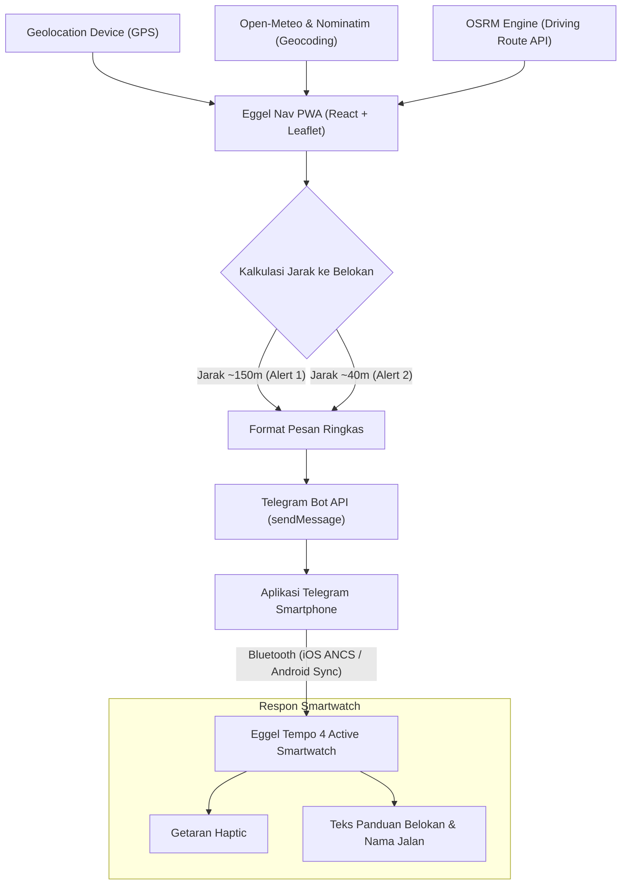

# Eggel Nav

> Turn-by-Turn Motorcycle Navigation PWA for Eggel Tempo 4 Active Smartwatch  
> Navigasi motor dengan notifikasi getar dan panduan arah pada smartwatch melalui integrasi Telegram Bot dan sinkronisasi notifikasi iOS (ANCS) / Android.

---

## Sekilas Tentang Project

**Eggel Nav** adalah aplikasi navigasi Turn-by-Turn berbasis **Progressive Web App (PWA)** yang dirancang untuk pengendara sepeda motor pengguna smartwatch **Eggel Tempo 4 Active** maupun smartwatch lain yang mendukung penerimaan notifikasi via Bluetooth.

Smartwatch pada kategori ini umumnya tidak memiliki sistem operasi mandiri seperti WearOS/watchOS atau aplikasi peta bawaan. Namun, perangkat ini dibekali motor getar (*haptic vibration*) dan layar yang andal dalam menampilkan notifikasi pesan dari smartphone.

**Pendekatan Eggel Nav:**  
Smartphone memproses kalkulasi rute dan pergerakan GPS secara real-time, lalu mengirimkan instruksi belokan ringkas ke Telegram Bot pribadi pengguna. Notifikasi tersebut otomatis diteruskan oleh Bluetooth (melalui ANCS pada iOS atau Notification Listener pada Android) ke smartwatch, menghasilkan **getaran pergelangan tangan** dan **tampilan arah manuver belokan** tanpa pengendara perlu membuka atau menatap layar smartphone saat berkendara.

---

## Fitur Utama

- **Turn-by-Turn Motorcycle Navigation**: Perutean kendaraan bermotor menggunakan engine Open Source Routing Machine (OSRM) dengan instruksi manuver visual yang presisi.
- **Smartwatch Haptic Vibration (Dual-Alert System)**:
  - **Peringatan 1 (Advance Turn Warning ~150m)**: Memberi getaran dan instruksi persiapan belokan (misal: `[150m] BELOK KIRI`).
  - **Peringatan 2 (Imminent Turn Execution ~40m)**: Memberi getaran penegasan saat titik belokan berada tepat di depan (misal: `[40m] BELOK KIRI SEKARANG`).
- **Pencarian Lokasi Cerdas (Hybrid Geocoding)**:
  - **Open-Meteo Geocoding** sebagai mesin pencari primer: tanpa batasan kuota ketat (bebas error 429), latensi rendah (<50ms), serta mencakup data administratif kelurahan, kecamatan, dan kota di Indonesia.
  - **OSM Nominatim Fallback**: Dilengkapi mekanisme *request pacing* otomatis (1.200ms) untuk mencegah pelanggaran kuota saat mencari nama tempat atau gedung spesifik.
  - **In-Memory Query Cache**: Mengurangi beban jaringan dengan menyimpan riwayat pencarian dalam sesi aktif.
  - **Auto-Resolution Area Perumahan**: Memetakan pencarian nama perumahan privat (contoh: *Patraland Tasikmadu Malang*) ke entitas administratif yang terdaftar.
- **Background & Sensor Keep-Alive (iOS & Android)**:
  - **Silent Audio Loop & WebAudio Oscillator**: Mencegah sistem operasi mematikan proses GPS di latar belakang saat smartphone berada di dalam saku atau layar terkunci.
  - **Screen WakeLock API**: Menjaga layar tetap aktif saat smartphone dipasang pada holder motor.
- **Desain Eggel Active Sports**:
  - Palet warna athletic: Carbon Black (`#0f0f12`), Electric Lime (`#d2fc15`), dan Sky Cyan (`#38bdf8`).
  - Dukungan tema Dark Mode dan Light Mode.
  - HUD navigasi berukuran proporsional agar mudah dipantau sekilas.
- **Dukungan Dua Bahasa**: Tersedia dalam Bahasa Indonesia dan English.
- **100% Free & Open-Source**: Beroperasi penuh tanpa ketergantungan pada API key berbayar seperti Google Maps Platform atau Mapbox.

---

## Alur Arsitektur Sistem



---

## Tech Stack

| Komponen | Teknologi |
| :--- | :--- |
| **Framework** | React 19, Vite |
| **Styling** | Tailwind CSS v4 |
| **Peta Interaktif** | Leaflet (OpenStreetMap Tile Layer) |
| **Routing Engine** | OSRM Driving API |
| **Geocoding** | Open-Meteo Geocoding API & OpenStreetMap Nominatim |
| **Notifikasi Smartwatch** | Telegram Bot API |
| **Keep-Alive Service** | Web Audio API, HTML5 Audio Loop, Screen WakeLock API |
| **Icon System** | Lucide React |
| **Linter** | Oxlint |

---

## Instalasi & Menjalankan Lokal

### Prasyarat
- Node.js versi 18 atau lebih baru.
- Koneksi internet aktif untuk memuat peta dan rute OSRM.

### 1. Kloning Repositori & Instal Dependensi
```bash
git clone https://github.com/username/eggel-nav.git
cd eggel-nav
npm install
```

### 2. Jalankan Server Pengembangan
```bash
npm run dev -- --host
```
Argumen `--host` membuka akses jaringan lokal agar aplikasi dapat dibuka langsung dari browser smartphone pada Wi-Fi yang sama.

Alamat akses:
- **Perangkat Komputer**: `http://localhost:5173/`
- **Smartphone (Jaringan Lokal)**: `http://<IP-KOMPUTER>:5173/` (misal: `http://192.168.1.50:5173/`)

### 3. Kompilasi Produksi
```bash
npm run build
npm run preview
```

---

## Konfigurasi Smartwatch Eggel Tempo 4 Active

Untuk menerima getaran notifikasi arah pada smartwatch:

### 1. Pembuatan Telegram Bot
1. Buka aplikasi **Telegram** di smartphone.
2. Buka kontak **`@BotFather`** dan kirim pesan `/newbot`.
3. Tentukan nama dan username bot sesuai petunjuk.
4. Salin **HTTP API Token** yang diberikan (contoh: `8863619482:AAH_lEWklKmgu...`).

### 2. Mengetahui Chat ID Akun
1. Buka kontak **`@userinfobot`** di Telegram dan tekan tombol **Start**.
2. Simpan angka **Id** akun Anda yang ditampilkan (contoh: `5694188432`).
3. Buka bot yang telah dibuat pada langkah 1, lalu kirim pesan apa saja (atau tekan **Start**) agar bot diizinkan mengirim pesan ke akun Anda.

### 3. Input Pengaturan di Eggel Nav
1. Buka antarmuka **Eggel Nav** di browser smartphone.
2. Buka menu **Settings (Pengaturan)** di sudut kanan atas.
3. Masukkan **Telegram Bot Token** dan **Telegram Chat ID**.
4. Tekan tombol **"Uji Getar Jam Sekarang" (Test Watch Vibration Now)** untuk memverifikasi transmisi pesan dan getaran pada jam.

### 4. Verifikasi Izin Notifikasi Aplikasi Pendamping Jam
- Buka aplikasi pendamping smartwatch di smartphone (**Eggel Fit**, **GloryFit**, atau sejenisnya).
- Masuk ke menu **Device** > **Notification / App Alerts**.
- Pastikan izin notifikasi untuk aplikasi **Telegram** telah diaktifkan (**ON**).

---

## Panduan Instalasi PWA (Layar Utama Smartphone)

Eggel Nav mendukung fungsionalitas PWA penuh melalui Web App Manifest dan Service Worker:

- **iOS (Safari)**:
  1. Buka alamat Eggel Nav di Safari.
  2. Tekan ikon **Share** (kotak dengan panah ke atas) pada bilah navigasi bawah.
  3. Pilih opsi **"Add to Home Screen" (Tambahkan ke Layar Utama)**.

- **Android (Chrome)**:
  1. Buka alamat Eggel Nav di Google Chrome.
  2. Tekan menu titik tiga di sudut kanan atas.
  3. Pilih opsi **"Install App"** atau **"Add to Home screen"**.

---

## Struktur Direktori

```text
eggel-nav/
├── public/
│   ├── favicon.svg              # Favicon Eggel Nav
│   ├── icon-192.png             # Ikon PWA 192x192
│   ├── icon-512.png             # Ikon PWA 512x512
│   ├── apple-touch-icon.png     # Ikon iOS Home Screen
│   ├── manifest.json            # Web App Manifest
│   └── sw.js                    # Service Worker caching
├── src/
│   ├── components/
│   │   ├── Map.jsx              # Render peta Leaflet, marker posisi, & garis rute
│   │   ├── NavigationHUD.jsx    # Tampilan HUD manuver, jarak, & durasi perjalanan
│   │   ├── SearchModal.jsx      # Modal pencarian tempat dengan auto-debounce
│   │   └── SettingsModal.jsx    # Pengaturan token Telegram, ambang jarak, & bahasa
│   ├── utils/
│   │   ├── audioKeepAlive.js    # Background tracking keep-alive (Audio & WakeLock)
│   │   ├── geo.js               # Kalkulasi formula Haversine, bearing, & jarak polyline
│   │   ├── i18n.js              # Manajemen teks lokalisasi (ID / EN)
│   │   ├── osrm.js              # Integrasi rute OSRM & hybrid geocoding
│   │   └── telegram.js          # Pengiriman pesan Telegram & formatting notifikasi
│   ├── App.jsx                  # State navigasi utama, pelacakan GPS, & koordinasi modul
│   ├── main.jsx                 # Entry point React & inisialisasi Service Worker
│   └── index.css                # Styling Tailwind CSS v4 & tema custom
├── package.json
├── vite.config.js               # Konfigurasi Vite & proxy Nominatim
└── README.md
```

---

## Privasi & Keamanan

- Kredensial Bot Token dan Chat ID disimpan secara lokal pada penyimpanan peramban (`localStorage`) perangkat Anda.
- Koordinat lokasi GPS diproses langsung secara lokal di sisi klien untuk keperluan navigasi dan tidak dikirimkan ke server penyimpanan data eksternal.

---

## Lisensi

Didistribusikan di bawah lisensi [MIT](LICENSE). Bebas digunakan, dikembangkan, dan disesuaikan untuk keperluan personal maupun komunitas.
